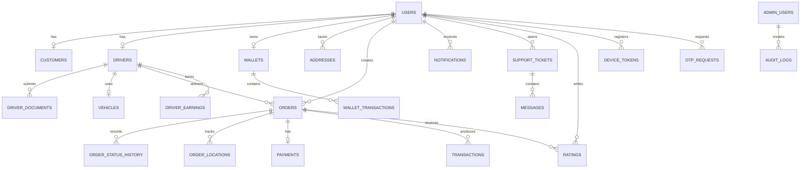

# ZAK | زاك — Phase 1: المعمارية الإنتاجية

## 1. قرار المعمارية

المشروع الحالي مبني بـ **Expo React Native + TypeScript** وليس Flutter + Dart. لذلك لن نعيد كتابة التطبيق بالكامل؛ لأن ذلك سيحذف ميزات منفذة ويزيد مخاطر الإطلاق. سنحتفظ بتطبيق Expo الحالي، ونحوّل الخادم تدريجياً إلى Modular Backend متوافق مع Node.js وTypeScript وPostgreSQL، مع فصل طبقات المجال والتكاملات.

سيكون العميل تطبيقاً واحداً يدعم أدوار العميل والسائق في المرحلة الحالية، مع إمكانية فصل تطبيق السائق لاحقاً إلى حزمة مستقلة. لوحة الإدارة والتاجر يمكن أن تكونا Web Apps منفصلتين عند الحاجة، بينما تبقى وحدات المجال مشتركة من خلال REST API وطبقة أنواع مشتركة.

> **قاعدة الإنتاج:** لا نعتبر بيانات الواجهة أو الحالة المحلية مصدراً للحقيقة في الأسعار، الصلاحيات، الدفع، رصيد المحفظة، إسناد الطلب، أو انتقالات حالة الطلب. الخادم وقاعدة البيانات هما المصدر الحقيقي.

## 2. النطاق والحدود

يستهدف ZAK السوق الليبي، مع واجهة عربية RTL ودعم الإنجليزية LTR، ورقم هاتف بصيغة ليبيا `+218`. الخدمات الرئيسية هي المطاعم والمتاجر والصيدليات والطرود والمشاوير والتوصيل السريع. النطاق الجغرافي الافتراضي للتوصيل هو 10 كم، ويجب ضبطه من `app_settings` لا من كود الواجهة.

النسخة الحالية تحتوي على أساس واجهات وبيانات تجريبية وطبقة حالات وصلاحيات مشتركة. هذه المرحلة لا تدّعي أن OTP أو الدفع أو GPS أو WhatsApp أو الإشعارات أصبحت إنتاجية؛ تلك تكاملات لاحقة تحتاج حسابات ومفاتيح رسمية واختبار Staging.

## 3. هيكل المستودع المقترح

```text
zak/
├── mobile/                         # تطبيق Expo الحالي
│   ├── app/                        # Expo Router screens
│   ├── components/
│   ├── lib/
│   ├── shared/
│   └── assets/
├── backend/                        # يمكن استخراج الخادم تدريجياً
│   ├── src/
│   │   ├── auth/
│   │   ├── users/
│   │   ├── customers/
│   │   ├── drivers/
│   │   ├── vehicles/
│   │   ├── addresses/
│   │   ├── orders/
│   │   ├── pricing/
│   │   ├── payments/
│   │   ├── wallet/
│   │   ├── notifications/
│   │   ├── otp/
│   │   ├── locations/
│   │   ├── ratings/
│   │   ├── coupons/
│   │   ├── support/
│   │   ├── admin/
│   │   ├── reports/
│   │   ├── audit/
│   │   └── common/
│   ├── tests/
│   ├── migrations/
│   └── .env.example
├── admin/                          # لوحة الإدارة لاحقاً
├── docs/
├── tests/
└── README.md
```

لا يلزم نقل كل الملفات الآن. النقل سيكون تكاملياً: نضيف الوحدات والواجهات إلى الخادم الحالي، ثم نفصلها فقط عندما يصبح ذلك مفيداً تشغيلياً.

## 4. نموذج البيانات ERD



الجداول الأساسية هي: `users`, `customers`, `drivers`, `driver_documents`, `vehicles`, `addresses`, `orders`, `order_status_history`, `order_locations`, `payments`, `transactions`, `wallets`, `wallet_transactions`, `driver_earnings`, `commissions`, `coupons`, `ratings`, `notifications`, `device_tokens`, `otp_requests`, `support_tickets`, `messages`, `admin_users`, `admin_permissions`, `audit_logs`, و`app_settings`.

كل جدول مالي أو تشغيلي حساس يحتاج `id`, `created_at`, `updated_at` عند ملاءمته، ومفاتيح خارجية وفهارس وقيود تحقق. لا نعدل قاعدة الإنتاج يدوياً؛ كل تغيير يمر عبر Migration قابلة للمراجعة.

## 5. الأدوار والصلاحيات

الأدوار الأساسية هي `CUSTOMER`, `DRIVER`, `ADMIN`, و`SUPER_ADMIN`. لا يستطيع المستخدم تغيير دوره بنفسه. التحقق من الدور والصلاحية يتم في Backend، أما إخفاء زر في الواجهة فهو تحسين تجربة فقط وليس حماية.

| المجال | العميل | السائق | المدير | المدير الأعلى |
|---|---:|---:|---:|---:|
| إنشاء طلب | نعم | لا | حسب الصلاحية | نعم |
| قبول رحلة | لا | نعم إذا كان معتمداً ومتوفراً | لا | نعم |
| تغيير سعر | لا | لا | حسب الصلاحية | نعم |
| اعتماد سائق | لا | لا | نعم | نعم |
| إدارة المستخدمين | لا | لا | حسب الصلاحية | نعم |
| رؤية السجلات الحساسة | لا | سجله فقط | حسب الصلاحية | نعم |
| إدارة الصلاحيات | لا | لا | لا | نعم |

## 6. آلة حالات الطلب

```text
PENDING
  → SEARCHING_DRIVER
  → DRIVER_ASSIGNED
  → DRIVER_ACCEPTED
  → DRIVER_ARRIVED
  → PICKED_UP
  → IN_DELIVERY
  → DELIVERED

من أي حالة تشغيلية مسموح بها → CANCELLED وفق سياسة الإلغاء
من حالات فشل محددة → FAILED
```

يمنع Backend الانتقالات غير القانونية مثل `DELIVERED → PENDING`، ويكتب كل انتقال في `order_status_history` مع المستخدم والوقت والسبب. يجب أن تكون عملية الإسناد وقبول السائق Idempotent وتمنع إسناد رحلتين متعارضتين للسائق نفسه.

## 7. قائمة REST API الأولية

| الوحدة | المسارات الأساسية |
|---|---|
| Auth | `POST /auth/request-otp`, `POST /auth/verify-otp`, `POST /auth/refresh`, `POST /auth/logout` |
| Users | `GET /me`, `PATCH /me`, `DELETE /me` |
| Addresses | `GET /addresses`, `POST /addresses`, `PATCH /addresses/:id`, `DELETE /addresses/:id` |
| Orders | `POST /orders`, `GET /orders`, `GET /orders/:id`, `POST /orders/:id/cancel`, `POST /orders/:id/rating` |
| Driver | `POST /drivers/apply`, `PATCH /drivers/status`, `GET /drivers/orders/nearby`, `POST /drivers/orders/:id/accept`, `POST /drivers/orders/:id/reject` |
| Tracking | `POST /orders/:id/location`, `GET /orders/:id/locations`, `GET /orders/:id/stream` |
| Pricing | `POST /pricing/quote` للعرض، مع إعادة الحساب الإلزامية عند إنشاء الطلب |
| Wallet | `GET /wallet`, `GET /wallet/transactions`, `POST /wallet/topups` |
| Payments | `POST /payments/intent`, `POST /payments/webhook`, `POST /payments/:id/refund` |
| Support | `POST /support/tickets`, `GET /support/tickets`, `POST /support/tickets/:id/messages` |
| Admin | `GET /admin/orders`, `GET /admin/drivers`, `POST /admin/drivers/:id/approve`, `POST /admin/drivers/:id/suspend`, `GET /admin/audit-logs` |

كل Endpoint يحتاج مخطط إدخال وإخراج، مصادقة، تفويض، Rate Limit عند الحاجة، ومعالجة أخطاء موحدة. WebSocket أو Socket.IO يضاف فقط لتتبع حي بعد تثبيت REST ومسار location موثوق.

## 8. التسعير والمدفوعات والمحفظة

السعر يحسب في Backend من الأجرة الأساسية والمسافة والانتظار والمنطقة والرسوم والخصم والطلب المرتفع. الواجهة تعرض Quote فقط، ولا يجوز لها إرسال Total موثوق إلى الخادم.

المحفظة Ledger وليست رقماً يعدّل مباشرة. كل حركة تحتوي على Transaction ID والمستخدم والمبلغ والنوع والحالة والمرجع والتاريخ. تحديث الرصيد والحركات المالية يتم داخل Database Transaction مع منع التكرار.

الدفع يمر عبر طبقة `PaymentProvider` قابلة لاستبدال المزود. نجاح الدفع لا يعتمد على رد الواجهة؛ الخادم ينتظر Webhook موثقاً ويتحقق من المبلغ والعملة والمرجع والتوقيع قبل تسجيل المعاملة وربطها بالطلب.

## 9. الخدمات الخارجية المطلوبة لاحقاً

| الحاجة | القرار الحالي | المطلوب قبل الإنتاج |
|---|---|---|
| OTP | طبقة `OTPService` قابلة للتبديل | مزود رسمي يدعم +218 وOTP وRate Limits |
| WhatsApp | خدمة مستقلة وليست بديلاً عن Push | WhatsApp Business API أو مزود رسمي وحساب أعمال |
| Push | طبقة إشعارات قابلة للتهيئة | FCM، Device Tokens، مفاتيح Android/iOS |
| الخرائط | واجهة Map موجودة/قابلة للتطوير | Google Maps Maps/Places/Geocoding/Routes ومفاتيح مقيدة |
| التخزين | طبقة تخزين خادم | Cloud Object Storage وسياسات رفع آمنة |
| الدفع | Abstraction Layer | مزود أو مصرف ليبي رسمي مع Sandbox وWebhook وتسوية |
| Redis | غير إلزامي في النسخة المحلية | Cache/Queue عند زيادة الطلبات أو الحاجة للمهام الخلفية |

لن نبحث أو نربط مزود دفع أو OTP محدداً قبل تحديد الشركة القانونية، الحساب التجاري، Sandbox، الرسوم، KYC، ودعم ليبيا رسمياً. لا نستخدم WhatsApp شخصياً ولا API غير رسمي.

## 10. البيئات والنطاقات

نحتاج ثلاث بيئات منفصلة: Development وStaging وProduction. لكل بيئة قاعدة بيانات وAPI ومفاتيح Maps وFirebase وStorage وPayment وOTP مستقلة. يمنع استخدام Production Database أثناء التطوير.

النطاقات المقترحة هي `zak.ly` للتسويق أو الويب، `api.zak.ly` للخادم، و`admin.zak.ly` للوحة الإدارة. لا نفترض شراءها أو توفرها. قبل الإنتاج يجب شراء النطاق المتاح، ضبط DNS، إصدار SSL، إجبار HTTPS، تقييد CORS، وإعداد مسارات API. هذه الخطوة تحتاج مالك النطاق أو صلاحية DNS من المستخدم.

## 11. الأمن والامتثال التشغيلي

يجب اختبار SQL Injection وXSS وCSRF وIDOR وJWT وRBAC وRate Limiting وإساءة OTP ورفع الملفات وتصعيد الصلاحيات والتلاعب بالسعر والدفع وتسريب الأسرار. لا توضع مفاتيح Backend أو كلمات المرور أو OTP أو Tokens داخل GitHub أو السجلات.

وثائق السائق تتحقق من النوع والحجم والامتداد وMIME، وترفع إلى تخزين غير قابل للتنفيذ بصلاحيات مؤقتة. كل إجراء إداري حساس يسجل في `audit_logs`.

سياسة الخصوصية والشروط والإلغاء والاسترجاع وشروط السائق يجب مراجعتها قانونياً في ليبيا. لا نعتبر النصوص القانونية صالحة قانونياً دون مراجعة مختص.

## 12. الأداء والمراقبة والنسخ الاحتياطي

تستخدم القوائم Pagination، وتستخدم قاعدة البيانات Indexes، ويضاف Debouncing للبحث، وLazy Loading للصور والبيانات، وConnection Pooling للخادم. لا نحمّل كل الطلبات مرة واحدة.

المراقبة تشمل API والخادم وقاعدة البيانات والأخطاء والانهيارات والدفع وOTP والإشعارات وWebSocket وCPU والذاكرة. نحتاج تنبيهات للأخطاء الحرجة. قاعدة البيانات تحتاج Backup آلياً وRetention وخطة Recovery واختبار استعادة فعلي.

## 13. التكاليف الشهرية التقديرية

هذه **تقديرات تخطيطية وليست عروض أسعار**؛ تتغير حسب المزود والمنطقة وحجم الطلبات ولا تشمل رسوم Apple أو Google أو الرسائل أو عمولات الدفع إلا عند استهلاكها.

| المرحلة | نطاق تخطيطي شهري | الافتراض |
|---|---:|---|
| تطوير محلي | 0 إلى 50 دولار | الخدمات المحلية وبيانات تجريبية |
| Staging صغير | 25 إلى 150 دولار | خادم صغير، قاعدة بيانات، تخزين، مراقبة أساسية |
| إنتاج أولي | 100 إلى 500 دولار | API وPostgreSQL ونسخ احتياطي وتخزين ومراقبة |
| نمو متوسط | 500 دولار فأكثر | عدة خوادم، Redis/Queue، خرائط، رسائل، مراقبة وتكرار |

تضاف رسوم النطاق، Apple Developer، Google Play Console، الخرائط، SMS/WhatsApp، الدفع، التخزين، والنسخ الاحتياطي بحسب العقود والاستخدام.

## 14. قائمة الإنتاج

| العنصر | الحالة الحالية |
|---|---|
| Expo Mobile وTypeScript | موجود |
| هوية ZAK وRTL | موجود جزئياً ومطبق في الواجهات الأساسية |
| آلة حالات الطلب | أساس مشترك موجود ومختبر |
| RBAC | أساس مشترك موجود؛ يحتاج فرضاً كاملاً في Backend |
| PostgreSQL migrations | موجودة جزئياً؛ تحتاج الجداول الإنتاجية كاملة |
| OTP رسمي | غير مربوط |
| WhatsApp Business API | غير مربوط |
| GPS حي وWebSocket | غير مكتمل |
| دفع ومصرف ومحفظة Ledger | غير إنتاجي |
| FCM | غير مكتمل |
| لوحة الإدارة والتاجر | أساس واجهات؛ تحتاج API وصلاحيات كاملة |
| Staging وProduction | غير معدّين |
| Backup وMonitoring | غير معدّين |
| Android APK للتجربة | يحتاج تسجيل دخول EAS وبناء preview |
| iOS TestFlight | يحتاج Apple Developer مدفوع ومفعّل |

## 15. خارطة الطريق

| المرحلة | الناتج |
|---|---|
| Phase 1 | هذه الوثيقة والقرارات المعمارية وحدود التنفيذ |
| Phase 2 | PostgreSQL Schema وMigrations وIndexes وConstraints |
| Phase 3 | Backend Base وREST conventions وError handling وConfig |
| Phase 4 | Phone Auth وOTPService وSecure Session وRate Limits |
| Phase 5 | Customer flows والعناوين والطلب والتاريخ |
| Phase 6 | Driver onboarding والوثائق والمركبة والتوفر |
| Phase 7 | Order State Machine وMatching وIdempotency |
| Phase 8 | Pricing Backend وQuotes وCoupons |
| Phase 9 | Maps وGeocoding وRoutes وETA |
| Phase 10 | GPS حي وWebSocket وOffline/Last Known Location |
| Phase 11 | FCM وDevice Tokens وWhatsApp service |
| Phase 12 | Payment abstraction وWebhook وRefund |
| Phase 13 | Wallet Ledger وDriver Earnings وCommissions |
| Phase 14 | مزود الدفع/المصرف بعد التحقق الرسمي |
| Phase 15 | OTP/WhatsApp/SMS production بعد توفير الحسابات |
| Phase 16 | Admin Dashboard وAudit وReports |
| Phase 17 | Support وTickets وMessages وAttachments |
| Phase 18 | Security review وThreat model وRate tests |
| Phase 19 | Monitoring وAlerts وBackup/Restore |
| Phase 20 | اختبارات التكامل والفشل والضغط |
| Phase 21 | Staging ومراجعة قبول المستخدم |
| Phase 22 | Production deployment الآمن |
| Phase 23 | Google Play وApp Store/TestFlight |

## 16. قرار الانتقال

وفق قاعدة المستخدم في الملف، هذه الوثيقة تنفذ **Phase 1 فقط**. لا ننتقل إلى Phase 2 ولا نضيف جداول أو تكاملات إنتاجية قبل اعتماد هذه القرارات، خصوصاً قرار الاستمرار على Expo بدلاً من إعادة الكتابة إلى Flutter، وحدود فصل تطبيق السائق ولوحة الإدارة، والنطاقات ومزودي الخدمات.

بعد تأكيد Phase 1، تكون أول حزمة تنفيذ هي Schema ومigrations غير مدمرة على بيئة Development/Staging، مع اختبارات قيود الطلبات والأدوار والمعاملات المالية قبل أي استخدام لقاعدة Production.
