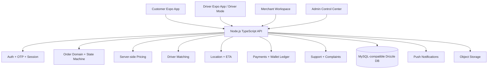

# ZAK | زاك — System Architecture

## 1. قرار التقنية

المواصفات المرفقة تقترح Flutter، لكن مشروع ZAK الحالي مبني ومستقر على **Expo SDK 54 + React Native + TypeScript + Expo Router + NativeWind**. وبما أن المواصفات تنص على عدم تغيير الـ Tech Stack بدون موافقة، سيستمر المشروع على هذا الأساس مع تطبيق نفس مبادئ التنظيم والأمان. هذا القرار يمنع إعادة كتابة التطبيق وكسر الشاشات الموجودة، ويتيح إصدار Android وiOS من قاعدة كود واحدة.

الخادم الحالي يستخدم **Node.js + TypeScript + tRPC + Drizzle ORM**. قاعدة البيانات الحالية معرفة عبر Drizzle، ويجب مراجعة مهاجراتها قبل إضافة جداول مالية أو صلاحيات جديدة. لن يتم تنفيذ Migration مدمرة أو تغيير قاعدة البيانات دون مراجعة مستقلة.

## 2. البنية العامة



> **قاعدة الثقة:** التطبيق يرسل طلباً، لكن الخادم هو المصدر النهائي للصلاحيات والسعر وحالة الدفع وانتقال حالة الطلب. لا نثق بأي Role أو سعر أو نجاح دفع قادم من الواجهة.

## 3. هيكل الملفات المقترح داخل Expo

```text
app/
  index.tsx                 # اختيار Welcome أو الجلسة المحفوظة
  welcome.tsx               # اللغة والتعريف الأولي
  auth.tsx                  # تسجيل الدخول والتسجيل
  verify.tsx                # OTP
  (tabs)/                   # تجربة العميل الأساسية
  cart.tsx
  checkout.tsx
  location.tsx
  wallet.tsx
  driver/                   # شاشات المندوب عند اكتمال المرحلة
  merchant/                 # مساحة التاجر
  admin/                    # مركز التحكم الإداري
  support/                  # الدعم والشكاوى
components/
  ui/                       # عناصر مشتركة وأيقونات
  forms/                    # نماذج مع Validation
  orders/                   # بطاقة الطلب، Timeline، حالات الطلب
  maps/                     # الخريطة، Marker، ETA
lib/
  auth/                     # الجلسة وOTP والصلاحيات
  orders/                   # State Machine وعمليات الطلب
  pricing/                 # تحويلات العرض فقط؛ الحساب النهائي في الخادم
  location/                 # النطاق وتحديثات الموقع
  payments/                # واجهات مزودي الدفع دون أسرار
  wallet/                  # Ledger وعرض الرصيد
  support/                 # الشكاوى والمرفقات
  localization/            # ar/en وRTL/LTR
server/
  routers.ts               # وحدات API مع Authorization
  db.ts                    # عمليات قاعدة البيانات
  domains/                 # منطق الأعمال المنفصل عن الواجهات
  services/                # Push، Storage، OTP، Payments
shared/
  types.ts                 # الأنواع المشتركة
  schemas/                 # Zod input/output schemas
  order-state.ts           # الحالات والانتقالات المسموحة
  permissions.ts           # Role-Based Access Control
```

## 4. نموذج البيانات الأولي ERD

```mermaid
erDiagram
  USERS ||--o| DRIVER_PROFILES : has
  USERS ||--o{ ADDRESSES : saves
  USERS ||--o{ ORDERS : creates
  DRIVER_PROFILES ||--o| VEHICLES : uses
  DRIVER_PROFILES ||--o{ ORDERS : fulfills
  ORDERS ||--o{ ORDER_STATUS_HISTORY : records
  ORDERS ||--o{ ORDER_ITEMS : contains
  USERS ||--o| WALLETS : owns
  WALLETS ||--o{ TRANSACTIONS : records
  ORDERS ||--o| PAYMENTS : has
  USERS ||--o{ RATINGS : writes
  ORDERS ||--o{ SUPPORT_TICKETS : concerns
  USERS ||--o{ SUPPORT_TICKETS : opens
  SUPPORT_TICKETS ||--o{ MESSAGES : contains
  USERS ||--o{ NOTIFICATIONS : receives
  USERS ||--o{ AUDIT_LOGS : creates

  USERS { int id PK; string role; string phone; datetime createdAt }
  DRIVER_PROFILES { int id PK; int userId FK; string approvalStatus; boolean online; decimal rating }
  VEHICLES { int id PK; int driverId FK; string type; string plateNumber }
  ADDRESSES { int id PK; int userId FK; string label; decimal latitude; decimal longitude }
  ORDERS { int id PK; string orderNumber UK; int customerId FK; int driverId FK; string status; decimal total; datetime createdAt }
  ORDER_STATUS_HISTORY { int id PK; int orderId FK; string fromStatus; string toStatus; datetime createdAt }
  ORDER_ITEMS { int id PK; int orderId FK; string name; decimal quantity; decimal unitPrice }
  WALLETS { int id PK; int userId FK; decimal balance }
  TRANSACTIONS { int id PK; int walletId FK; string type; decimal amount; string reference; datetime createdAt }
  PAYMENTS { int id PK; int orderId FK; string provider; string status; string providerReference }
  RATINGS { int id PK; int orderId FK; int authorId FK; int score }
  SUPPORT_TICKETS { int id PK; int userId FK; int orderId FK; string status; string priority }
  MESSAGES { int id PK; int ticketId FK; int senderId FK; string body; string attachmentUrl }
  NOTIFICATIONS { int id PK; int userId FK; string type; string readAt }
  AUDIT_LOGS { int id PK; int actorId FK; string action; string entity; datetime createdAt }
```

الجداول الحالية (`users`, `driver_profiles`, `delivery_orders`) تمثل نواة أولية وليست بديلاً عن النموذج التجاري الكامل. قبل إضافة جداول جديدة يجب إنشاء Migration غير مدمرة، وإضافة فهارس على `orderNumber`, `customerId`, `driverId`, `status`, و`createdAt`.

## 5. الأدوار والصلاحيات

| الدور | الصلاحيات الأساسية | الممنوعات |
|---|---|---|
| Customer | إنشاء طلب، حفظ عنوان، الدفع، التتبع، التقييم، الشكوى | تغيير Role، تعديل سعر الخادم، الوصول لطلبات غيره |
| Driver | Online/Offline، استقبال طلب قريب، قبول/رفض، تحديث الرحلة، الأرباح | استقبال طلب وهو موقوف أو Offline، قفز حالة، رؤية بيانات غير لازمة |
| Merchant | إدارة منتجاته، قبول الطلب، وقت التجهيز، تقارير متجره | الوصول لمتاجر أو طلبات خارج نطاقه |
| Admin | إدارة التشغيل، السائقين، الطلبات، التسعير، الشكاوى | تغيير سجلات مالية دون Audit Log |
| Super Admin | إدارة Admin وإعدادات النظام الحساسة | استخدام الحساب دون MFA/Audit عند تفعيل الإنتاج |

كل Endpoint يجب أن يطبق Authentication ثم Authorization على الخادم. إخفاء زر في الواجهة ليس حماية.

## 6. آلة حالات الطلب

الحالات القياسية:

```text
PENDING
  -> SEARCHING_DRIVER
  -> DRIVER_ASSIGNED
  -> DRIVER_ACCEPTED
  -> DRIVER_ARRIVED
  -> PICKED_UP
  -> IN_DELIVERY
  -> DELIVERED

PENDING / SEARCHING_DRIVER / DRIVER_ASSIGNED / DRIVER_ACCEPTED
  -> CANCELLED وفق قواعد الإلغاء

أي حالة تشغيلية
  -> FAILED عند فشل موثق فقط
```

كل انتقال يجب أن يتحقق من الحالة الحالية، Role المنفذ، ملكية الطلب، وشرط الانتقال. يجب تسجيل كل انتقال في `order_status_history` مع الوقت من الخادم، ومنع الضغط المكرر باستخدام idempotency key أو تحقق فريد من العملية.

## 7. API Modules

الوحدات المستهدفة:

```text
/auth
/users
/customers
/drivers
/merchants
/orders
/payments
/wallet
/locations
/notifications
/coupons
/ratings
/support
/admin
```

كل إجراء موثق داخلياً بهذه العناصر: `Method`, `Input schema`, `Authentication`, `Authorization`, `Business rules`, `Response`, و`errorCode`. صيغة الأخطاء الموحدة:

```json
{
  "success": false,
  "message": "رسالة مفهومة للمستخدم",
  "errorCode": "ORDER_INVALID_TRANSITION",
  "data": null
}
```

لا نعيد Stack Trace أو مفاتيح أو تفاصيل قاعدة البيانات للمستخدم.

## 8. التسعير والدفع

الصيغة التجارية المقترحة:

```text
subtotal + baseFare + distanceFee + waitingFee + additionalFees
- discount - coupon
+ surge (if enabled)
= total
```

يحسب الخادم السعر اعتماداً على مواقع ومعدلات موثوقة. الواجهة تعرض تقديراً فقط. تأكيد الدفع يأتي من الخادم أو مزود الدفع، وكل حركة محفظة تسجل في Ledger؛ لا يتم تعديل الرصيد مباشرة بدون Transaction.

## 9. التتبع والمطابقة

يتم اختيار السائق فقط إذا كان الحساب `Approved`، والمستندات معتمدة، والحالة `Online`، ولا توجد رحلة نشطة تمنعه. تحديث الموقع يكون دورياً ومحدوداً مع تقليل الاستهلاك، ويُعرض للعميل فقط أثناء الطلب المسموح له برؤيته. لا يتم تفعيل GPS في الخلفية دون صلاحية واضحة من المستخدم.

## 10. خارطة التنفيذ المرحلية

| المرحلة | النتيجة | الحالة |
|---|---|---|
| 1. Architecture | هذه الوثيقة، الأدوار، ERD، API، State Machine | موثقة |
| 2. Database | جداول ومهاجرات وفهارس غير مدمرة | لاحقاً |
| 3. Authentication | OTP آمن، جلسة محفوظة، تغيير رقم آمن | نواة موجودة، يحتاج تقوية إنتاجية |
| 4. Customer | الطلب، العنوان، السلة، الدفع، الشكوى | نواة موجودة |
| 5. Driver | التسجيل، الاعتماد، Online، رحلة واحدة | نواة موجودة |
| 6. Orders | انتقالات خادم صارمة وIdempotency | يحتاج توسعة |
| 7. Maps | GPS، ETA، تحديثات محسنة | جزئي |
| 8. Payments | Cash أولاً ثم مزودات فعلية | محاكاة/نواة فقط |
| 9. Notifications | Push حسب دور وحالة | يحتاج تفعيل إنتاجي |
| 10. Admin/Merchant | صلاحيات ولوحات منفصلة | نواة واجهات |
| 11. Security | مراجعة Authorization ورفع الملفات وRate Limits | يحتاج تدقيق |
| 12. Testing | اختبارات النجاح والفشل والصلاحيات | جزئي |
| 13. Deployment | Android وiOS ونسخ الإنتاج | Android قيد البناء، iOS ينتظر Apple |

## 11. حدود هذه المرحلة

هذه الوثيقة تطبق **مرحلة التخطيط المعماري** من الملف داخل مشروع ZAK، ولا تدّعي أن التكاملات الخارجية مثل WhatsApp OTP، GPS الخلفي، مزود الدفع، FCM، أو TestFlight أصبحت إنتاجية. سيتم تنفيذ كل مرحلة على حدة، مع اختبارها وتوثيق ملفاتها قبل الانتقال للمرحلة التالية.

## 12. قرار Phase 2: Merchant Backend-only

في **Phase 2 Development-Only**، يكون دور Merchant **Backend-only**. لا توجد شاشة Merchant، ولا يوجد Merchant route أو Merchant UI component ضمن واجهة التطبيق في هذه المرحلة. واجهة التاجر مؤجلة إلى مرحلة مستقبلية مستقلة بعد اعتماد نطاقها واختبارها.

التدفق التجريبي الأساسي الحالي هو **Customer → Order → Driver**. وجود Merchant كدور أو Permission مذكور في التصميم الخلفي لا يعني وجود واجهة Merchant؛ فالـRole والـPermission يصفان نموذج الصلاحيات، بينما الشاشة والـroute يمثلان واجهة مستخدم منفصلة وغير موجودة في Phase 2.
